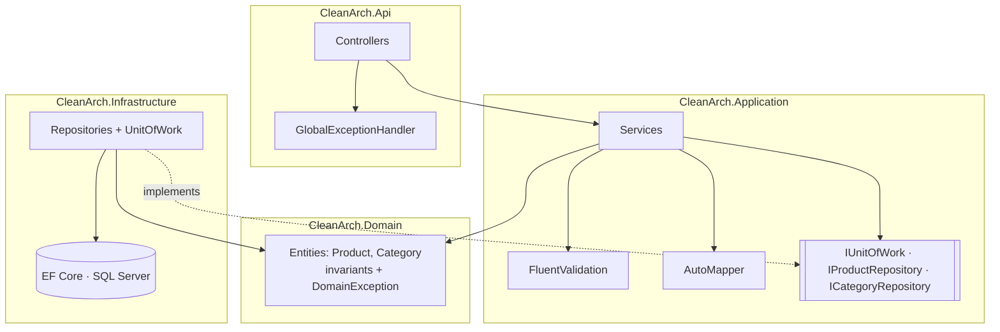

# .NET Clean Architecture API

[](https://github.com/CH88320B/dotnet-clean-architecture/actions/workflows/ci.yml)


A product catalog **ASP.NET Core 8 Web API** that follows **Clean Architecture**. The domain has no framework dependencies, business rules are unit-tested in isolation, and infrastructure (EF Core + SQL Server) is a replaceable detail behind interfaces.

## Features

- **Four layers**: Domain → Application → Infrastructure → API, with dependencies pointing inward only
- **Repository pattern + Unit of Work** over EF Core. One `SaveChangesAsync` commits a whole use case
- **FluentValidation** for request validation, returned as `ValidationProblemDetails`
- **AutoMapper** for entity → DTO mapping (configuration is asserted in tests)
- **Pagination, filtering and sorting**: `search`, `categoryId`, `minPrice`, `maxPrice`, `inStock`, `sortBy`, `sortDirection`, `page`, `pageSize`
- **Optimistic concurrency** with a SQL Server `rowversion`, surfaced as `409 Conflict`
- **RFC 7807 problem details** for every error via a global `IExceptionHandler`
- **Swagger/OpenAPI** with XML doc comments, plus a `/health` endpoint with a DB check
- **xUnit + Moq + FluentAssertions** tests, and **Docker Compose** with SQL Server 2022

## Architecture



| Layer | Depends on | Contains |
|-------|-----------|----------|
| **Domain** | nothing | Entities, invariants (`RemoveStock`, price/stock rules), `DomainException` |
| **Application** | Domain | Use-case services, DTOs, validators, mapping profile, persistence interfaces |
| **Infrastructure** | Application | `AppDbContext`, entity configurations, repositories, unit of work |
| **Api** | Application, Infrastructure | Controllers, exception → HTTP mapping, Swagger, composition root |

### Error mapping

| Exception | HTTP status |
|-----------|-------------|
| `ValidationException` (FluentValidation) | 400 with per-field errors |
| `NotFoundException` | 404 |
| `ConflictException` (duplicate SKU, concurrency, unique index) | 409 |
| `DomainException` (e.g. insufficient stock) | 422 |
| anything else | 500 (logged, no internals leaked) |

## Getting started

### With Docker (recommended)

```bash
docker compose up --build
```

Open **http://localhost:5080/swagger**. The database is created and seeded with demo categories and products on first start.

### Locally

Prerequisites: .NET 8 SDK and a SQL Server instance (`docker compose up sqlserver` works).

```bash
dotnet restore
dotnet run --project src/CleanArch.Api
```

Set the connection string through `ConnectionStrings__Default` or user secrets. To manage schema changes with migrations instead of `EnsureCreated`:

```bash
dotnet tool install --global dotnet-ef
dotnet ef migrations add InitialCreate -p src/CleanArch.Infrastructure -s src/CleanArch.Api
```

Once migrations exist, the startup initializer applies them automatically.

### Run the tests

```bash
dotnet test
```

## API examples

```bash
# Filter + sort + paginate
curl "http://localhost:5080/api/products?search=monitor&minPrice=100&inStock=true&sortBy=price&sortDirection=Asc&page=1&pageSize=10"

# Create
curl -X POST http://localhost:5080/api/products -H "Content-Type: application/json" \
  -d '{"sku":"HS-100","name":"Headset","price":59.99,"stock":15,"categoryId":"<category-id>"}'

# Remove 3 units of stock (422 if not enough)
curl -X POST http://localhost:5080/api/products/<id>/stock -H "Content-Type: application/json" -d '{"quantity":-3}'
```

Paged response:

```json
{
  "items": [ { "id": "…", "sku": "MN-027", "name": "27\" 4K Monitor", "price": 329.00, "stock": 8, "categoryName": "Monitors" } ],
  "page": 1,
  "pageSize": 10,
  "totalCount": 1,
  "totalPages": 1,
  "hasNextPage": false,
  "hasPreviousPage": false
}
```

## Project structure

```
.
├── src/
│   ├── CleanArch.Domain/          # Entities and business rules
│   ├── CleanArch.Application/     # Services, DTOs, validators, mapping, abstractions
│   ├── CleanArch.Infrastructure/  # EF Core, repositories, unit of work, seeding
│   └── CleanArch.Api/             # Controllers, middleware, Program.cs
├── tests/
│   ├── CleanArch.Domain.UnitTests/
│   └── CleanArch.Application.UnitTests/
├── Dockerfile
└── docker-compose.yml
```

## License

[MIT](LICENSE)
